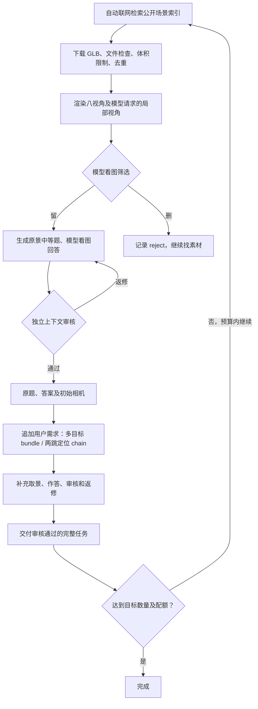

# 3D-Surfing：自动找素材与 3D 探索题生产

**这是一套自动造题流程：程序自行联网找 3D 场景，下载后让模型看图筛选、出题、回答、审核和返修，最终交付「3D 场景 + 初始视角 + 题目 + 答案 + 审核证据」。** 题目需要通过旋转、换焦或放大观察场景来解决。

默认只需要配置模型、渲染环境和目标题量，**不需要预先提供场景 URL、`sources.jsonl`、本地素材库或已经做好的原题**。素材或可用原题不足时，程序会继续在线检索、下载并筛选。

默认在本地运行和渲染，K8s 是可选渲染后端。这里的“本地运行”指调度、文件处理和渲染的执行位置；**素材发现、下载以及通常使用的模型服务仍需要联网**。模型与渲染分别配置，后续可替换 Codex provider 或模型适配器。

## 默认完整流程



默认完整入口是 `tools/start_followup_batch.py`，其内部运行 `sceneqa workflow followup-batch`。它会自动串联在线发现、筛选、原题生成和二次增难，**不需要先单独运行 `auto` 或准备原题种子**。

| 你配置什么 | 程序自动完成什么 | 最终得到什么 |
|---|---|---|
| 模型账号 / API、渲染环境、输出目录、目标题量 | 在线找素材、下载、真实取景、模型留删、原题与答案、审核返修、追加增难与审核 | 每题一个 GLB、初始相机与图片、完整题目、模型答案、审核记录 |

## 素材从哪里来

当前默认来源是 [Stable-X/ProSceneverse 在线元数据](https://huggingface.co/datasets/Stable-X/ProSceneverse)。程序按预置关键词检索场景，再通过 Objaverse 的公开路径索引找到并下载对应 GLB。检索覆盖市场摊位、码头、营地、庭院、室内工作间和居家场景；实际室内 / 室外标签由模型看渲染图确认。

这是已接入的公开在线来源；当前没有实现任意网站的通用搜索和下载。主流程也不默认复用仓库中的历史 `catalog/` 素材池。每个新任务建立自己的在线索引与缓存；同一输出目录续跑会复用本批次已验证的文件和记录。

来源阶段检查可下载地址、许可、体积和重复文件，保留作者、来源页和单资产许可证。场景是否内容丰富、是否值得探索、是否具备清楚的出题证据，交给模型观察真实图片判断。下载或接口错误记录为 `failed`；质量不合格记录为 `reject`。留删清单不会删除原资产。详见[在线发现](docs/AUTO_PIPELINE.md)和[筛选规则](docs/SCREENING_RULES.md)。

## 产出的两类题

- **多目标 `bundle`**：保留原题，再追加两个不同目标的问题，三个答案必须全对。
- **空间链 `chain`**：从原题目标出发，连续做两跳相互依赖的空间选择，再回答最后目标的属性；需要提交原题答案、两步选择和最终答案。

一份复合任务计一题，子问题不拆开重复计数。默认目标 **200 题 = 两类各 100 题**，每类室内、室外各 50。每个场景每类最多产出一题，因此完成 200 题至少需要 100 个不同场景；同文件哈希的不同 UID 不重复出题。

当前主流程保留原景物件，二次增难通过追加用户需求完成，保留原题文字与初始相机。模型应选择起始视角被遮挡、探索后能够明确回答的目标。它不要求每题必须操作固定轮数。具体题目标准见[用户追加增难](docs/USER_FOLLOWUP.md)。

## 安装与配置

需要 Python 3.10+。先完整克隆仓库，再进行源码 editable 安装；部分实现仍调用仓库内的 `tools/` 和 `experiments/sol_augment/`。

```bash
git clone https://github.com/wzhwzhwzh0921/3D-Surfing.git
cd 3D-Surfing
python3 -m venv .venv
.venv/bin/pip install -e '.[batch,render]'
cp .env.example .env
# 编辑 .env，填好自己的模型配置，然后加载：
set -a
source .env
set +a
.venv/bin/sceneqa workflow config
```

仓库包含 Python 代码、Prompt、worker 和一个渲染测试 GLB，不依赖开发机的其他代码目录或既有场景。模型服务 / 凭据、Codex CLI 和系统图形驱动需要自行准备；数据集与模型权重不打包在仓库中。当前支持完整源码安装，尚不支持把单独 wheel 脱离源码目录运行。

默认模型后端是 Codex CLI + ChatGPT 登录，示例模型为 `gpt-6.1-sol`。使用此模式时先运行 `codex login`、`codex login status`；自定义 provider / HTTP API 的配置见下文。程序不会自动读取 `.env`，每次新终端启动前需加载配置。

主线 GLB 渲染使用 `trimesh + pyrender`，不要求 Blender 桌面版。Linux 需要可用的 EGL / OpenGL 驱动，可使用 GPU，也可使用 Mesa 软件渲染。Ubuntu 系统依赖起点为 `libegl1 libgl1 libgl1-mesa-dri libglib2.0-0`，安装与设备选择见[渲染说明](docs/RENDERING.md)。

## 一条命令：自动找素材并造 200 题

在仓库根目录完成上述配置后，直接启动：

```bash
.venv/bin/python tools/start_followup_batch.py \
  --out runs/online-200 --target 200
```

**这条命令不需要场景 URL、素材清单、`--catalog` 或 `--seed-campaign`。** 程序会自行联网找新场景，从零完成原题及两类复合任务的生产。小规模试跑可把 `--target` 改为 `4`，并另选新的输出目录。

启动器在后台运行，冻结代码与 Prompt；终端断开后仍继续。默认使用本地串行渲染和单个 Codex 模型调用。先选好渲染后端；如本机不适合渲染，可在启动前配置下文的 K8s 后端。

- `<out>/summary.json`：当前阶段、真实保留题量、模式及室内外配额。
- `<out>/production.log`：生产日志；`gallery.html` 展示最多 20 份代表题，完整交付索引为 `delivery-manifest.jsonl`。
- `<out>/STOP`：创建该文件可在安全检查点停止；删除后用原命令、原配置重启续跑。

目标数量统计的是审核通过的完整任务。来源耗尽、预算不足或配额无法满足时会明确记录未完成。后台启动器默认最多处理 5,000 个新素材，可用 `--max-scenes` 修改；429、5xx、超时重试和断点续跑已保留。磁盘空间不足时等待，不自动删资产。详细操作见[批量生产](docs/FOLLOWUP_BATCH.md)。

## 模型接口与可选 K8s

| 接入方式 | 主要配置 |
|---|---|
| Codex + ChatGPT 登录（默认） | `SCENEQA_MODEL_BACKEND=codex`、`SCENEQA_CODEX_AUTH=chatgpt`、`SCENEQA_MODEL=你的模型名` |
| Codex + 自己的 provider | `SCENEQA_MODEL_BACKEND=codex`、`SCENEQA_CODEX_AUTH=configured`、`SCENEQA_MODEL=你的模型名` |
| 直接调用多模态 HTTP API | `SCENEQA_MODEL_BACKEND=relay`、`SCENEQA_API_URL`、`SCENEQA_API_KEY`、`SCENEQA_MODEL` |

Codex 自定义 provider 使用你私有目录里的配置；示例见 [codex-provider.example.toml](examples/codex-provider.example.toml) 和 [Codex 官方配置文档](https://learn.chatgpt.com/docs/config-file/config-advanced#custom-model-providers)。配置好后可设置：

```bash
export SCENEQA_CODEX_AUTH=configured
export SCENEQA_CODEX_PROVIDER=sceneqa_custom
export SCENEQA_MODEL=your-vision-model
export SCENEQA_CODEX_REASONING=inherit
# provider 的密钥设在私有环境中，不写进仓库。
```

模型需要支持多图和结构化输出；Codex provider 使用 Responses 协议，直接 HTTP 模式使用完整的 `chat/completions` 地址。`inherit` 表示不额外覆盖推理档位。另有 `ModelBackend.complete(payload)` 插件接口，详见[模型接入说明](docs/MODEL_INTERFACE.md)。

K8s 只替换渲染执行位置，模型调用和生产编排仍由主程序负责。使用自己的命名空间、镜像和必要的镜像拉取 Secret：

```bash
export SCENEQA_RENDER_BACKEND=k8s
export SCENEQA_NAMESPACE=your-namespace
export SCENEQA_RENDER_IMAGE=your-registry/sceneqa-render:tag
# export SCENEQA_IMAGE_PULL_SECRET=your-pull-secret
.venv/bin/python tools/start_followup_batch.py \
  --out runs/k8s-online-200 --target 200
```

本地默认运行不需要 kubectl 或集群。选择 K8s 后，集群失败不会静默回退本地渲染。镜像示例在 [deploy/render/Dockerfile](deploy/render/Dockerfile)，资源配置见[渲染后端](docs/RENDERING.md)。

## 可选入口与阶段区别

| 入口 | 自动找新素材 | 用途与产出 |
|---|---|---|
| `tools/start_followup_batch.py` / `workflow followup-batch` | 是 | **完整主线**：发现、筛选、原题、追加增难及审核，交付复合任务 |
| `workflow auto` | 是 | 只生产中等原题及答案，输出 `selected.jsonl` |
| `workflow followup` | 否，读取已有原题 | 对已审核原题追加多目标 / 空间链需求 |
| `workflow screen` → `workflow qa` | 手动指定素材 | 对 URL / 本地 GLB 清单筛选、生成原题 |
| `workflow smoke` | 否 | 渲染环境自检，**不造题、不调用模型** |
| `workflow augment` / `workflow export` | 否 | 早期三档物件增强实验，见[历史说明](docs/LEGACY_CLAUDE_DEEPSEEK.md) |

已有审核通过的原题时，可选择给后台主入口添加 `--seed-campaign runs/originals`；这是可选加速方式。参数指向带 `selected.jsonl` 的完整原题输出目录，不能用素材清单代替。`--exclude-history old.jsonl` 则仅按历史 UID 排除重复，不把旧素材当作新来源。

只生产原题可单独运行：

```bash
.venv/bin/sceneqa workflow auto --out runs/originals --target 10 --max-scenes 200
```

手动指定素材时，创建 JSONL：

```json
{"uid":"scene_001","url":"https://example.org/scene.glb"}
{"uid":"scene_002","source_glb":"/absolute/path/to/scene.glb"}
```

替换示例地址后运行 `workflow screen --sources sources.jsonl --out runs/screen`，再运行 `workflow qa --sources runs/screen/keep.jsonl --out runs/qa`。这是按需使用的分阶段入口，默认自动生产无需准备此文件。

## 交付、Prompt 与验证范围

每题在 `tasks/<uid>/<mode>/delivery/` 交付：

```text
scene.glb       原场景，保留材质
start.png       初始视角
task.json       原题、追加需求、初始相机、逐项作答要求
answers.json    模型看图给出的答案
audit.json      独立上下文审核记录
```

`task.json` 是解题侧输入，不含答案或内部候选；`answers.json` 和 `audit.json` 留给评估侧。原题阶段另有 `question.json`、`reveal.png`。在线来源、局部取景、模型原始响应和返修过程也保存在输出目录，见[代码与文件地图](docs/WORKFLOW_MAP.md)。

| 内容 | 代码 / Prompt |
|---|---|
| 在线素材检索 | `scene_factory/sources.py`、`live_sources.py` |
| 主生产编排 | `automation.py`、`followup_production.py` |
| 模型与渲染接口 | `model_backend.py`、`codex_backend.py`、`rendering.py` |
| 当前场景筛选 Prompt | `scene_factory/screening/prompts/v5.txt` |
| 追加需求、作答、审核 Prompt | `scene_factory/prompts/followup_*_zh.txt` |
| 原题与返修 Prompt | `experiments/sol_augment/run.py`、`repair_medium.py` |
| 独立原题审核 | `tools/independent_qa_audit.py` |

答案和质量判断来自模型观察，程序检查格式、文件与证据一致性。审核与作答默认使用同一模型的独立上下文，审核能看到候选答案，尚非盲审或人工 gold；不保证每题需要固定数量的操作。保留率、答案正确率与实际解题难度应分别衡量。

安装后可选做渲染自检，此命令会实际渲染配置后端中的仓库小样：

```bash
.venv/bin/sceneqa workflow smoke --out runs/render-smoke
```

它只生成 17 张测试图并核对原 GLB 不变，**不会在线找素材或生成正式题目**。独立安装、Mesa 软件渲染和实际模型图像调用的范围见[验证记录](docs/PORTABILITY_CHECK.md)。

开发回归检查使用 mock 模型和 mock 集群，不执行真实 3D 渲染或付费模型调用：

```bash
.venv/bin/python -m unittest discover -s tests -q
```

后台任务绑定冻结代码、模型 / provider 身份、渲染配置和证据哈希。换模型、后端或协议后用新的输出目录；旧批次继续使用自己的 `runtime/` 或 `workflow_snapshot/`，不随主仓库文档更新而改变。
