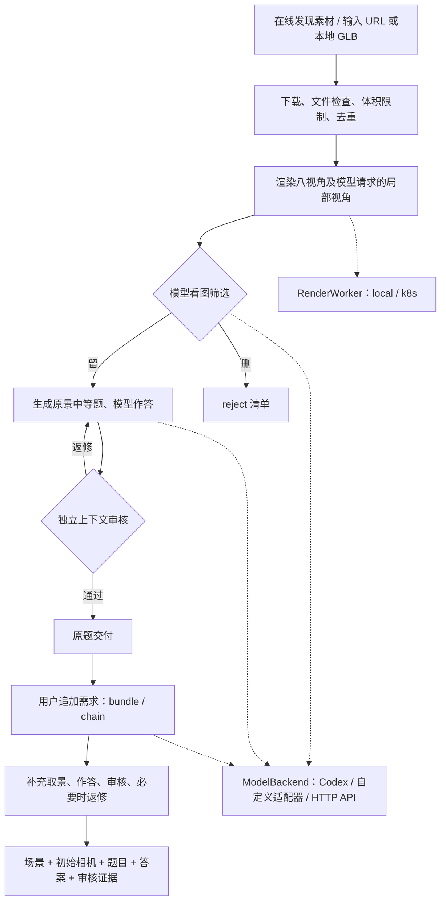

# 3D-Surfing：场景探索问答 Pipeline

从带材质的 GLB 场景生成需要转动视角、换焦或放大观察的问答任务。支持在线找素材，也支持输入自己的 URL / 本地 GLB；筛选、出题、作答、审核、返修均保留记录。

**默认在本地运行和渲染。K8s 是可选渲染后端，不是流程依赖；模型名称、Codex provider 与渲染后端分别配置。** 当前 GLB 主线使用 `trimesh + pyrender` 离屏渲染，不要求安装 Blender 桌面版。早期 `.blend` / Claude Code 实验仍保留，见[历史说明](docs/LEGACY_CLAUDE_DEEPSEEK.md)。

## 流程与输入输出



| 阶段 | 输入 | 输出 / 入口 |
|---|---|---|
| 发现与下载 | 在线元数据，或 JSONL 中的 `url` / `source_glb` | 本地 GLB、来源、作者、许可证；`auto` / `screen` |
| 场景筛选 | GLB、标准视角、按需局部图 | `keep.jsonl` / `reject.jsonl` / `failed.jsonl`；`screen` |
| 原题生产 | 筛选保留的场景 | 中等题、模型答案、初始相机、审核与返修记录；`qa` |
| 二次增难 | 已审核原题的 `selected.jsonl` | `bundle` 或 `chain`；`followup` |
| 连续生产 | 目标数量、可选原题种子 | 自动补充素材与原题，累计审核通过的完整任务；`followup-batch` |
| 展示 | 交付与证据 | 本地 `gallery.html`；可选 `tools/export_followup_batch.py` 导出静态网站 |

`bundle` 保留原题并增加两个不同目标的问题，三个答案必须全对。`chain` 保留原题，再做两跳相互依赖的空间定位，交付要求回答原题、两步选择和最终属性。子问题不拆开重复计数。默认 200 题为两类各 100；每类室内、室外各 50，按模型观察确认环境标签。见[增难规则](docs/USER_FOLLOWUP.md)与[批量说明](docs/FOLLOWUP_BATCH.md)。

## 安装与配置

需要 Python 3.10+。请使用完整源码仓库及 editable 安装，部分主线实现仍调用 `tools/` 和 `experiments/sol_augment/`。

本仓库包含运行所需的 Python 代码、Prompt、worker 和一个小型渲染测试 GLB，不依赖开发机上的其他项目或既有场景目录。模型服务/凭据、Codex CLI、系统图形驱动属于外部运行条件；在线发现素材时还需要网络。数据集和模型权重不打包进代码仓库。当前支持整仓库克隆后 `pip install -e ...`，尚不支持把单独 wheel 脱离源码目录运行。

```bash
python3 -m venv .venv
.venv/bin/pip install -e '.[batch,render]'
cp .env.example .env
# 编辑 .env 后加载；程序不会自动读取它。
set -a
source .env
set +a
.venv/bin/sceneqa workflow config
.venv/bin/sceneqa workflow list
```

Linux 离屏渲染需要可用的 EGL / OpenGL 驱动；无显示器不需要打开桌面。Ubuntu 可先安装 `libegl1 libgl1 libgl1-mesa-dri libglib2.0-0`；也可配置 OSMesa。依赖、线程限制、独立渲染 Python 及排错见[渲染后端](docs/RENDERING.md)。

默认模型后端是 Codex CLI，使用 `codex login` 登录的 ChatGPT 账号；示例模型是之前测试的 `gpt-6.1-sol`，可以替换。订阅模式先运行 `codex login status`。模型不在本机推理，本地负责调度与渲染。

安装后可先做**不调用模型、不下载素材**的渲染自检；此命令会实际执行配置后端的 3D 渲染：

```bash
.venv/bin/sceneqa workflow smoke --out runs/render-smoke
```

通过时生成 8 张标准视角、8 张原景输出视角、1 张换焦/旋转/缩放局部图，并核对原 GLB 字节未变；结果记录在 `summary.json`。这个检查验证渲染和文件交付，不评价模型出题质量。[独立安装、软件渲染及模型图像调用的验证记录](docs/PORTABILITY_CHECK.md)。

## 接入自己的模型

三个常用方式，均保持同一 pipeline：

| 方式 | 配置 | 适用情况 |
|---|---|---|
| Codex + ChatGPT 登录 | `SCENEQA_MODEL_BACKEND=codex`、`SCENEQA_CODEX_AUTH=chatgpt`、`SCENEQA_MODEL=你的模型名` | 使用订阅账号可用的模型 |
| Codex + 自定义 provider | `SCENEQA_MODEL_BACKEND=codex`、`SCENEQA_CODEX_AUTH=configured`、`SCENEQA_MODEL=你的模型名` | 读取你自己的 Codex 配置和 provider 凭据，不强制 OpenAI provider 或 ChatGPT 登录 |
| 直接调用兼容 HTTP API | `SCENEQA_MODEL_BACKEND=relay`、`SCENEQA_API_URL`、`SCENEQA_API_KEY`、`SCENEQA_MODEL` | 仅有多模态 `chat/completions` 接口，暂不经 Codex |

自定义 Codex provider 示例在 [examples/codex-provider.example.toml](examples/codex-provider.example.toml)。按 [Codex 官方配置文档](https://learn.chatgpt.com/docs/config-file/config-advanced#custom-model-providers)配置 Responses 协议、模型及认证，再设置：

```bash
export SCENEQA_CODEX_AUTH=configured
export SCENEQA_CODEX_PROVIDER=sceneqa_custom
export SCENEQA_MODEL=your-vision-model
export SCENEQA_CODEX_REASONING=inherit
# 在私有环境中设置 provider 使用的密钥，不写进仓库。
```

需要模型支持多图输入与结构化输出；`chat/completions` 地址不能直接当作 Codex 的 Responses provider。`inherit` 表示不额外覆盖推理档位。也预留了 `ModelBackend.complete(payload)` 插件接口；接入示例、输入输出协议、缓存与凭据处理见[模型接口](docs/MODEL_INTERFACE.md)。

## 从一批自己的场景试跑

创建 `sources.jsonl`，每行一个场景，`uid` 唯一：

```json
{"uid":"scene_001","url":"https://example.org/scene.glb"}
{"uid":"scene_002","source_glb":"/absolute/path/to/scene.glb"}
```

替换示例路径或 URL 后执行：

```bash
.venv/bin/sceneqa workflow screen --sources sources.jsonl --out runs/screen
.venv/bin/sceneqa workflow qa --sources runs/screen/keep.jsonl --out runs/qa
```

筛选由模型观察内容丰富度、可探索区域和出题机会；文件对象数不直接等于有用内容数。`keep` / `reject` 只记录清单，不删除原资产；下载、接口、渲染或格式错误记入 `failed`，不当作质量淘汰。默认文件上限 64 MiB，可通过各入口 `--max-bytes` 调整。见[筛选规则](docs/SCREENING_RULES.md)。

端到端生成原题：

```bash
.venv/bin/sceneqa workflow auto --out runs/originals --target 10 --max-scenes 200
```

随后基于审核通过的原题追加需求：

```bash
.venv/bin/sceneqa workflow followup \
  --campaign runs/originals --out runs/followup --limit 4 --modes bundle chain
```

后台连续生产 200 题（种子原题可省略，不足时自动在线补充）：

```bash
.venv/bin/python tools/start_followup_batch.py \
  --out runs/followup-200 --target 200 \
  --seed-campaign runs/originals
```

默认本地串行渲染、单个 Codex 模型调用。先用小目标确认自己的驱动和模型兼容性，再扩大目标。`summary.json` 显示真实完成数；达到审核通过数量才成功，来源耗尽或预算不足会明确记为未完成。429、5xx、超时重试与断点续跑已保留。建立输出目录下的 `STOP` 文件可在安全检查点停止，删除后用同一配置续跑。

## 可选：使用 K8s 渲染

K8s 仅替换 `RenderWorker` 的执行位置：上传同一 worker 和 GLB，取回同格式图片、相机及清单；模型调用、筛选和出题仍由 pipeline 调度。不部署专用服务，不依赖我们的命名空间、私有镜像或模型 Secret。

```bash
export SCENEQA_RENDER_BACKEND=k8s
export SCENEQA_NAMESPACE=your-namespace
export SCENEQA_RENDER_IMAGE=your-registry/sceneqa-render:tag
# 私有镜像需要时设置：
# export SCENEQA_IMAGE_PULL_SECRET=your-pull-secret
.venv/bin/sceneqa workflow auto --out runs/k8s-originals --target 10
```

默认请求 1 张 GPU，可配置为 0，但镜像必须具有可用的软件 OpenGL 驱动。仓库提供 [deploy/render/Dockerfile](deploy/render/Dockerfile) 作为镜像起点。集群失败不会静默改成本地渲染。配置表及部署要求见[渲染后端](docs/RENDERING.md)。

## 交付、Prompt 与代码位置

每份复合任务的 `delivery/`：

```text
scene.glb       原场景，保留材质
start.png       初始视角
task.json      解题侧输入：原题、追加需求、相机、逐项作答要求
answers.json    评估侧模型答案
audit.json     独立上下文审核记录
```

`task.json` 不含答案和内部候选；不要把 `answers.json`、`audit.json` 给解题模型。原题阶段另有 `question.json`、`reveal.png`。原始素材、按需取景、逐轮响应和返修过程保存在输出目录，见[代码与文件地图](docs/WORKFLOW_MAP.md)。

- `scene_factory/workflow.py`：统一 CLI；`automation.py` / `followup_production.py`：生产编排。
- `scene_factory/model_backend.py` / `codex_backend.py`：模型接口与 Codex 适配。
- `scene_factory/rendering.py`：本地 / K8s 渲染后端；`screening/inspection.py`：模型请求的相机取景。
- `scene_factory/screening/prompts/v5.txt`：当前场景筛选 Prompt。
- `scene_factory/prompts/followup_*_zh.txt`：追加需求、作答、审核 Prompt。
- 原题与返修 Prompt 目前在 `experiments/sol_augment/run.py`、`repair_medium.py`；独立原题审核在 `tools/independent_qa_audit.py`。

审核与作答默认是同一模型的独立上下文，审核能看到候选答案，尚非盲审；通过不等于人工 gold，也不保证必须操作固定轮数。保留率、语义答案正确率和实际解题难度需分别衡量。

## 开发与版本隔离

```bash
.venv/bin/python -m unittest discover -s tests -q
```

回归测试使用 mock 模型、mock 集群和轻量文件 fixture，不启动真实 3D 渲染或调用付费模型。`workflow config/list/--help` 同样不执行渲染。

后台批次冻结代码和 Prompt，绑定模型 / provider 身份、渲染配置和证据哈希。改模型、后端或协议后请使用新的输出目录；旧批次继续用其 `runtime/` 或 `workflow_snapshot/`，不要删除指纹强行续跑。当前机器上已有的 K8s 生产批次保留其原快照，本仓库的新默认值不会改变它。
