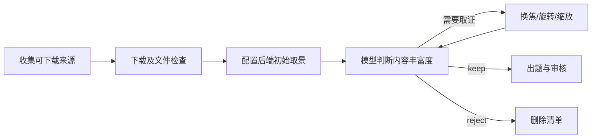

# 场景探索信息筛选 v5

2026-10-14 新任务默认 v5。来源在线重新检索，不读取旧素材池；历史 UID 只用于排除重复。默认最终题组的室内、室外数量分别约占一半，标签由实际3D视图确认，不能使用检索关键词代替。

拟保留前必须请求至少一次 真实3D局部取证。模型需给出至少三道不同目标、至少两种题型的问题，附可观察答案、视图证据和为什么需要探索，覆盖至少两个内容不同的区域。完整物件/类别数量是描述性估计，**不再硬性要求20件/8类/3区域**。通过仍要求内容丰富、真实信息增益和清楚答案，空外壳、重复装饰、大片破面与主要物件残缺应删除。

筛选候选问题只用来判断场景能否出题，不是最终答案。正式出题后模型重新看实际成品回答，另一个独立上下文审核遮挡、指代和答案证据。程序只验证输出结构和文件完整性，不核验语义答案。v5原文见 [v5.txt](../scene_factory/screening/prompts/v5.txt)，旧 v4 可显式用 `--screen-version v4` 或 `--version v4` 复现，不能沿用旧验收意见。

## 以下为 v4 历史规则

2026-10-08 起新任务默认使用 v4，来源阶段取消面数、材质数、纹理数、标题词和类别质量门槛。目标是保留原生内容物丰富的紧凑场景；不是仅能出一道题、也不是以后可通过增强补救。模型估计仍需抽查，数字门槛尚未校准成可靠的质量标准。旧资产和历史结果不移动、不批量重筛。

## 简化流程



质量判断只在模型筛选阶段发生。程序保留下载地址、原有在线许可/来源要求、35 MiB文件上限、GLB有效性、UID安全和去重。类别只用于均衡抽样；显式 `--query` 只限制检索范围，默认不启用。没有面数/材质/纹理元数据不会被提前淘汰，最终下载仍受实际体积限制。

## 各阶段职责

| 层 | 实现 | 当前检查 | 局限 |
|---|---|---|---|
| 来源准备 | `sources.py::source_restriction`、`prepare_batch_sources.py` | 实际GLB地址、原有在线许可/来源、已知体积、去重；类别仅用于均衡 | 不评判复杂度，所有内容判断交给模型 |
| 文件准备 | `screening/intake.py`、`download.py` | 安全 UID、可下载性、GLB 头、体积、SHA256 去重 | 不证明语义物件数或场景质量 |
| 视觉内容筛选 | `screening/rich.py`、`prompts/v4.txt` | 模型先看八图，列出实际物件类别/区域；拟保留时主动请求局部3D证据 | 数量是模型保守估计，仍可能数错、漏看、误认 |
| 问答审核 | `scene_feedback_loop.py`、`independent_qa_audit.py`、`delivery_qa_gate.py` | 题目指代、起始遮挡、答案证据、摆放及自由相机可答性 | 模型审核不是人工 gold 或真实解题成功率 |

## v4 内容门槛

当前试行默认：至少 **20 个可辨完整物件、8 类、3 个具有不同内容的区域**。分别可通过 `--min-objects / --min-categories / --min-regions` 调整。门槛用于小样本对照，不能解释成已验证的最佳阈值。

- 算完整家具、工具、器具、容器、食品、书本、玩具等；不能把一个椅子的零件、墙、地板、地形和水面凑成物件数。
- 同义类别合并，同一物件跨视图去重。重复树木、岩石、建筑外壳不能冒充丰富内容；数量达标但内容单一仍应删除。
- 区域需要不同实际内容，比如工具台、货架、储物角；不能把同一堆东西强行分成左中右。小而密集的单间也可通过。
- 只有小岛地形、几棵树、一间外壳小屋应删除。小岛若原生包含丰富的不同内容，仍可按同一标准判断。
- 不凭名称或常识猜封闭屋内。不用“以后加几个玩具就可以”作为保留理由。
- 低多边形、素色、建筑面积小本身都不是删除理由。

程序仅检查响应格式、门槛一致性和证据引用，**不从 GLB 节点数计算语义物件数，不自动验证模型的物件判断或题目答案**。

## 先看全景，再主动进行 3D 取证

初始采用四方位 45°/135°/225°/315°，每个 overview 与 closer，共八图。

```text
captures/<uid>/
  az_045_overview.png  az_135_overview.png
  az_225_overview.png  az_315_overview.png
  az_045_closer.png    az_135_closer.png
  az_225_closer.png    az_315_closer.png
```

明显稀少的场景可以直接 reject。**拟保留的场景必须至少请求一次局部真实3D取证**，并在最终理由中引用该新视图；不能仅看全景就 keep。

模型输出内部 `inspect` 动作，自行选择参照图、归一化 bbox、yaw/pitch/zoom。程序在参照相机下读取深度，对 bbox 中心附近的可见表面做反投影，得到3D焦点，再绕焦点旋转和缩放。不是裁剪原图；遮挡物不会被射线穿透，也不会自动隐藏屋顶或墙。

| 参数 | 含义/范围 |
|---|---|
| `reference_view` | 已给出的初始图或后续 inspect 图标签 |
| `bbox` | 左上角起算的 `[x1,y1,x2,y2]`，每项0..1 |
| `yaw` | 绕焦点转动，-180..180度 |
| `pitch` | 改变俯仰，-75..75度，正值抬高 |
| `zoom` | 0.5..6，>1靠近焦点 |
| `purpose` | 本次要确认哪些物件/区域 |

默认最多2轮、每轮2张补图，可用 `--inspection-rounds / --views-per-round` 修改。3D 渲染使用可替换后端，默认本地子进程，也可选择 K8s；一批共用按需启动的 worker，见[渲染配置](RENDERING.md)。预算不足、无表面可聚焦或渲染失败都记 failed，不假装是质量 reject。

最终模型返回 keep/reject、中文理由、`object_count_lower_bound`、带证据的 `categories / regions / exploration_evidence`。原文和完整结构见 [v4.txt](../scene_factory/screening/prompts/v4.txt)。v1/v2/v3 保留历史行为，可通过 `--version v3` 复现旧筛选。

## 运行

```bash
sceneqa workflow screen --sources sources.jsonl --out /data/rich-screen-new
```

复用旧八图仍需提供原始 GLB，以便追加真实取证：

```bash
sceneqa workflow screen-images --version v4 \
  --queue uids.txt --sources sources.jsonl \
  --captures /data/captures --output /data/rich-screen-new
```

`sources.jsonl` 每行含 `uid` 和绝对 `source_glb`。只有图片且模型请求取证时会 failed；不能用图片裁剪替代3D操作。v4取证依赖完整源码仓库和集群配置。

## 输出、缓存与重试

- keep / reject：机器留删意见；“删”只写清单，不物理删除。
- failed：下载、接口、格式、证据不足或渲染处理失败，单独统计。
- 内部 inspect 是取证动作，不是第三种场景筛选状态。

`screen` 来源清单保留 `screen_assessment` 和逐件记录路径；详细数据位于 `screen/v4/<uid>/`：正文、原始响应、`history.json`、`record.json`、取证请求、相机和新视图。`gallery.html` 展示八图、补图、物件清单及区域。数量均标注模型估计。

v4缓存指纹包括原GLB内容、初始图、prompt、模型/接口、试行门槛、取证预算和渲染器代码；新视图缺失或哈希变化也会失效。不会沿用v3“保留”意见。失败不作成功缓存；旧记录归档到 `attempt_*`。v1-v3原缓存计算保持不变。

每次模型请求 `temperature=0`、`max_tokens=4000`、180秒超时、最多3次尝试；429和500/502/503/504重试，数字 Retry-After 单次最多等60秒。v1-v3保留1200输出token。格式/证据反馈最多2次，取证轮数另有预算。真实接口返回 usage 后才计服务端缓存token，本地复用不算新增消耗。

## 尚需校准

1. 去掉廉价质量预筛后，更多来源会实际下载、取景并调用模型，成本可能增加；流程简化不等于模型调用减少。
2. 20/8/3只是试行值，可能误杀某类小而有趣的场景，也可能被模型虚报满足。应对照实际图册调整。
3. 计数、分类、跨视图去重仍是模型任务。明确JSON结构不等于事实正确。
4. 固定初始八图可能看不到封闭内部；局部换焦也不会穿墙。取证不足必须保留为处理问题。
5. 通过丰富度筛选不代表能稳定产出多道好题；问答审核继续独立执行。
6. 当前增强实现对可复制完整组和节点规模的限制是实现条件，不是内容丰富度定义。

来源发现协议已升级为 `sceneqa-discovery-v3-multi-source`；旧游标和带旧质量预筛的 `prepared.json` 不能在新协议下静默复用。新任务使用新输出目录并从原始来源重新准备，历史快照和资产不改动。旧几何/材质参数为兼容接受但不生效。
